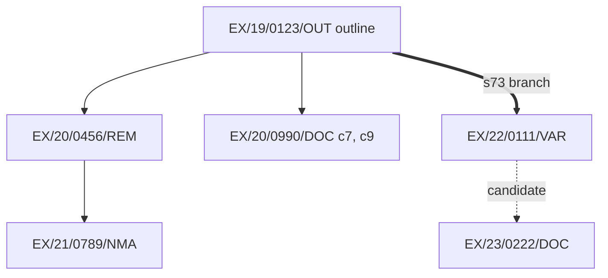

# Permission family: templates and examples

Load at the Respond step. Templates fix the shape of the output; examples show common mistakes next to the correct version. All references are synthetic.

## Templates

### T1 · Family tree

Markers: `[I]` instrument reviewed · `[S]` search only · `⎇` branch head (s73/s73A) · `⚑` flag.

```text
Family of EX/19/0123/OUT (root) · graph r[n] · entry point: [ref]

EX/19/0123/OUT  Outline  "Erection of up to 120 dwellings…"  Granted  Decision: 12/03/2020  [I]
├─ EX/20/0456/REM  Reserved matters (Phase 1: layout, scale, appearance)  Approved  Decision: 02/02/2021  [I]
│  └─ EX/21/0789/NMA  Non-material amendment to EX/20/0456/REM  Approved  Decision: 14/06/2021  [S]
├─ EX/20/0990/DOC  Details pursuant to conditions 7 and 9  Approved in part  Decision: 05/11/2020  [I]  ⚑ partial
└─ ⎇ EX/22/0111/VAR  s73: variation of condition 4 (phasing)  Granted  Decision: 20/09/2022  [I]
   └─ EX/23/0222/DOC  Details pursuant to condition 9 of EX/19/0123/OUT  Approved  Decision: 01/03/2023  [S]  ⚑ branch_target_ambiguous

Candidates (unconfirmed): EX/20/0457/REM, which shares a stem and site address (basis: inferred)
Unresolved references: s106 agreement dated 10/03/2020 (cited in EX/19/0123/OUT informative 2)
Ordered by: decision date as labelled on each source.
```

### T2 · Documents to obtain

```markdown
| # | Document | Why it matters | Currently |
| --- | --- | --- | --- |
| 1 | Decision notice EX/22/0111/VAR | Branch head; its conditions govern later approvals | Search only |
| 2 | Decision letter EX/23/0222/DOC | Confirms which branch the approval was made under | Search only |
```

### T3 · Diagram (only if asked)



### T4 · Reply footer (every reply)

```markdown
---
Instruments reviewed: [refs] · Family search: not performed (portal traversal unavailable)
Evidence cut-off: [date] · Graph: [location] r[n]
```

## Examples

Each pair shows the mistake (✗) and the correct version (✓).

**E1 · s73 drawn as an amendment (FAM-06)**
✗ `EX/22/0111/VAR` listed as a child amendment of the outline, with the outline's condition 4 shown as changed
✓ `EX/22/0111/VAR` drawn as a branch head (`⎇`) under the outline, with its own children; the outline's conditions are shown unchanged

**E2 · Approval copied across branches (COND-05, FAM-09)**
✗ Condition 9 of EX/22/0111/VAR marked "approved", because EX/23/0222/DOC approved condition 9 of the outline
✓ EX/23/0222/DOC drawn against the condition it cites, flagged `branch_target_ambiguous`; nothing placed on the s73 branch

**E3 · Candidate promoted from a reference pattern (REL-02)**
✗ "EX/19/0123/OUT/A is an NMA to the outline."
✓ `possibly_related_to`, basis "reference suffix", listed under candidates until @decision-notice records wording that states the link

**E4 · Search-only member drawn as a permission (PERM-02)**
✗ EX/22/0111/VAR shown as a reviewed s73 permission, from a search row reading "Granted"
✓ Shown as `[S]` with ⚑ `search_only_member`, and its decision notice listed first under documents to obtain

**E5 · Operative conclusion (CORE-04, FAM-04)**
✗ "The s73 permission superseded the outline, which has lapsed."
✓ "Two branch heads are recorded (EX/19/0123/OUT, EX/22/0111/VAR). ⚑ overlapping_permissions: no conclusion drawn on which is operative."

**E6 · Reading an instrument during family mapping (contract)**
✗ Opening an uploaded decision notice and adding its conditions to the family view directly
✓ Calling @decision-notice on EX-22-0111-VAR.pdf, then mapping from the revision it writes. The footer lists the notice under instruments reviewed.
